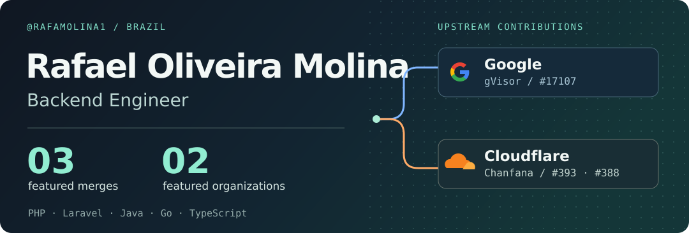

[](#open-source-contributions)

# Rafael Oliveira Molina

I’m a backend engineer from Brazil with five years of experience building APIs and distributed systems for logistics and SaaS. At Zinger Transportation, I tripled load processing throughput from **20 to 60 loads per second**. In open source, I work on Linux compatibility in **Google’s gVisor**, API documentation in **Cloudflare’s Chanfana**, and accessibility for **Data.gov**, a U.S. federal government system.

[Portfolio](https://rafamolinadev.vercel.app/) · [LinkedIn](https://www.linkedin.com/in/rafaelmolinadev/) · [Email](mailto:rafaeloliveiramolina@gmail.com) · [Merged pull requests](https://github.com/search?q=author%3Arafamolina1+is%3Apr+is%3Amerged+is%3Apublic&type=pullrequests)

## Open source contributions

<div align="left">
  <a href="https://github.com/gvisor/gvisor/pull/17107"></a>
  <a href="https://github.com/cloudflare/chanfana/pulls?q=is%3Apr+is%3Amerged+author%3Arafamolina1"></a>
  <a href="https://github.com/GSA/datagov-catalog/pull/521"></a>
  <a href="https://github.com/search?q=author%3Arafamolina1+is%3Apr+is%3Amerged+is%3Apublic&amp;type=pullrequests"></a>
</div>

<br />

| Project | Pull request | Contribution |
| --- | --- | --- |
| **U.S. Federal Government · Data.gov** | [#521](https://github.com/GSA/datagov-catalog/pull/521) · Approved, awaiting merge | Restored accessible colors for file format badges on Data.gov. Added 20 browser test cases covering contrast, keyboard focus and other regressions across the 13-color palette. |
| **Google · gVisor** | [#17107](https://github.com/gvisor/gvisor/pull/17107) | Fixed access control for `/proc/[pid]/fdinfo` in Go by enforcing ptrace read permission. Added regression tests in C++. |
| **Cloudflare · Chanfana** | [#393](https://github.com/cloudflare/chanfana/pull/393) | Upgraded the API docs UI to ReDoc 3.1.0, disabled anonymous telemetry by default, and documented the migration. |
| **Cloudflare · Chanfana** | [#388](https://github.com/cloudflare/chanfana/pull/388) | Added `redoc_options` to the Hono and itty-router adapters, enabling custom ReDoc attributes such as OpenAPI extension filters. |

<!-- After each merge, add a row and update the featured organization counts and assets/upstream-profile.svg. -->

## Professional background

My core stack includes PHP, Laravel, Java, AWS, Azure, Kafka and RabbitMQ, with experience in system architecture, distributed systems, API design and automated testing.

Beyond software engineering, I'm a tech entrepreneur and a semifinalist in Brazil's largest startup reality show, with exclusive coverage featured on Globo and Globoplay. I've contributed to launching two mobile applications published on the App Store and Google Play and spoken at technology and innovation events, including Summit Iguassu Valley and Technovação.

I hold a C2 English certification from the University of Cambridge and am interested in remote backend engineering opportunities with international teams, focusing on scalable systems, performance optimization and reliable software.

```text
What I care about  →  clean boundaries, useful tests, observable systems and simple solutions
How I work         →  ownership from discovery to deploy, clear communication and steady delivery
Currently exploring → Java + Spring Boot, AI-enabled backends and cloud-native architecture
```

## Engineering toolbox

<div align="center">
  
</div>

<br />

<details>
  <summary><strong>See the complete toolbox</strong></summary>
  <br />

| Area | Technologies & practices |
|---|---|
| **Backend** | PHP, Laravel, Node.js, TypeScript, REST APIs, microservices, DDD, DTOs and Value Objects; project experience with Java and Spring Boot; working knowledge of C#/.NET |
| **Frontend & Mobile** | React, JavaScript, Flutter and Dart; working knowledge of Angular |
| **Data & Messaging** | PostgreSQL, SQL, Redis, Kafka, RabbitMQ, queues and asynchronous jobs |
| **Quality** | Pest, Jest, unit, integration and end-to-end testing, code review, Clean Code and SOLID |
| **Cloud & Delivery** | AWS, Azure, Oracle Cloud, Docker, Linux, Git, CI/CD, S3 and observability |
| **AI** | LLM integrations, Spring AI, prompt engineering, tool calling and Python for machine learning |

</details>


## Credentials & education

| Credential | Issuer |
|---|---|
| [**Google Cybersecurity**](https://www.coursera.org/account/accomplishments/specialization/9YKAIC5LL3K3) | Google |
| [**Google Data Analytics**](https://www.coursera.org/account/accomplishments/specialization/P4JTCGE443Z7) | Google |
| **Cambridge English C2 Proficiency** | University of Cambridge |
| [**Oracle Cloud Infrastructure Associate**](https://catalog-education.oracle.com/ords/certview/sharebadge?id=BDFB9AB79C56F27589ACAF192371337C6018A7054703F016272EF03BB4A76141) | Oracle |
| [**Machine Learning with Python**](https://courses.skillsbuild.skillsnetwork.site/certificates/3fb5ed10feed4d168371f409380546a7) | IBM |
| [**Data Privacy**](https://courses.skillsbuild.skillsnetwork.site/certificates/bb448a693e31473baa6fb78158bcc8f7) | IBM |
| [**Bootcamp Java Santander**](https://www.dio.me/certificate/KM1AIKT5/share) | Santander / DIO |

🎓 **Technology degree in Systems Analysis and Development** — Fundação Getulio Vargas (FGV), Apr. 2025–Dec. 2027  
🎤 Speaker at **Summit Iguassu Valley** and technology events in Foz do Iguaçu and Cascavel, Brazil  
🌍 Native Portuguese, advanced Spanish and **Cambridge-certified C2 English**, used daily in an international environment

## Let's build something useful

I'm open to **remote Backend opportunities** where I can own meaningful problems, help shape technical decisions and ship software that lasts.

<div align="center">
  <a href="https://rafamolinadev.vercel.app/"><strong>Portfolio</strong></a>
  &nbsp;•&nbsp;
  <a href="https://www.linkedin.com/in/rafaelmolinadev/"><strong>LinkedIn</strong></a>
  &nbsp;•&nbsp;
  <a href="mailto:rafaeloliveiramolina@gmail.com"><strong>Email</strong></a>
</div>

<p align="center"><sub>Build clearly. Test what matters. Ship with ownership.</sub></p>
